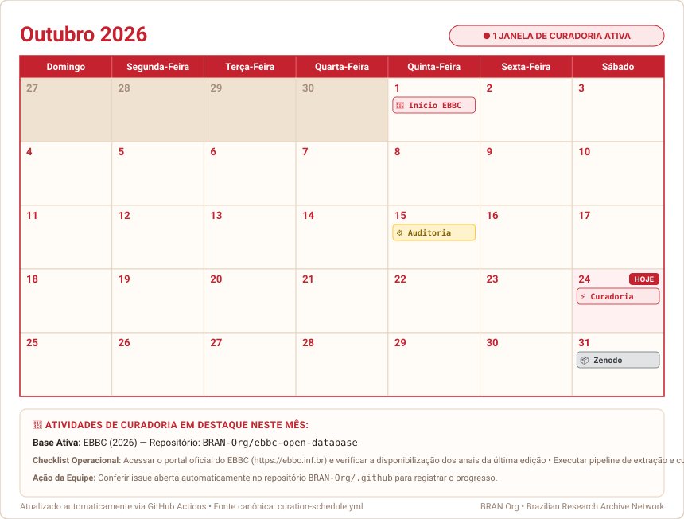

# Calendário de Curadoria e Governança de Dados - BRAN Org

A **BRAN Org** mantém um sistema de governança contínua para assegurar que as bases de dados acadêmicas (EBBC, ENANCIB, ABEC Meeting, DataGramaZero) sejam verificadas, atualizadas e preservadas com integridade.

Este sistema une **notificações automatizadas no GitHub** com **sincronização de calendário público (`.ics`)** para o Google Agenda, Apple Calendar e dispositivos móveis.

---

## Conferências do Mês

<p align="center">
  
</p>

---

## 1. Como Assinar no Google Agenda / Celular

Você pode assinar o calendário de curadoria para receber lembretes e visualizar as janelas de verificação diretamente no seu app de calendário habitual.

### URL Pública de Inscrição iCal (`.ics`):
```text
https://raw.githubusercontent.com/BRAN-Org/.github/main/calendar.ics
```

### Passo a Passo no Google Agenda (Web):
1. Abra o [Google Agenda](https://calendar.google.com).
2. Na barra lateral esquerda, localize a seção **"Outras agendas"** e clique no botão **`+`**.
3. Selecione a opção **"Do URL"** (*From URL*).
4. Cole o link:
   ```text
   https://raw.githubusercontent.com/BRAN-Org/.github/main/calendar.ics
   ```
5. Clique em **"Adicionar agenda"**.
6. A agenda aparecerá na sua lista e sincronizará automaticamente com seu celular (Android/iOS).

### No Apple Calendar (macOS / iOS):
- **macOS**: *Arquivo > Nova Assinatura de Calendário...* > cole a URL acima.
- **iOS**: *Ajustes > Calendário > Contas > Adicionar Conta > Outra > Adicionar Calendário Assinado*.

---

## 2. Matriz de Periodicidade das Bases

| Base de Dados | Periodicidade | Janela de Checagem | Repositório | Ações Principais |
| :--- | :--- | :--- | :--- | :--- |
| **EBBC** | Bienal (anos pares) | **Setembro e Outubro** | [`ebbc-open-database`](https://github.com/BRAN-Org/ebbc-open-database) | Verificar anais, rodar raspador, validar schema, atualizar Zenodo. |
| **ENANCIB** | Anual | **Dezembro e Janeiro** | [`enancib-open-database`](https://github.com/BRAN-Org/enancib-open-database) | Coletar trabalhos apresentados nos GTs, validar metadados e schema. |
| **ABEC Meeting** | Anual | **Dezembro e Janeiro** | [`abec-open-database`](https://github.com/BRAN-Org/abec-open-database) | Ingestão dos anais e resumos publicados pela ABEC Brasil. |
| **DataGramaZero** | Anual (auditoria fria) | **Julho** | [`datagramazero-open-database`](https://github.com/BRAN-Org/datagramazero-open-database) | Checagem de integridade de links/handles e cold storage no Zenodo. |

---

## 3. Automação de Issues no GitHub

Além do calendário, o workflow [BRAN Curation Calendar & Tasks](.github/workflows/curation-calendar.yml) roda no dia **1º de cada mês às 12:00 UTC (09:00 BRT)**:

1. **Inspeção de Janela**: Avalia se o mês e ano atuais coincidem com a janela de verificação de alguma base (respeitando cadências bienais e anuais).
2. **Deduplicação**: Consulta se já existe uma issue aberta ou fechada para o ciclo atual (ex: `[Curadoria] EBBC (2026)`). Se já existir, a criação é ignorada.
3. **Criação da Issue**: Se elegível, abre uma issue em `BRAN-Org/.github` com o checklist de curadoria completo e atribui ao mantenedor.

### Disparo Manual de Teste:
Você pode disparar a verificação manualmente na aba **Actions** do GitHub via `workflow_dispatch`, permitindo simular qualquer mês ou ano específico com ou sem a flag `dry_run`.

---

## 4. Como Adicionar ou Modificar Bases

A fonte da verdade de todo o calendário é o arquivo [`curation-schedule.yml`](curation-schedule.yml).

Para cadastrar um novo evento ou alterar uma janela de verificação:
1. Edite `curation-schedule.yml`.
2. Ao realizar o `git push`, o GitHub Actions regenerará o `calendar.ics` automaticamente.
3. Se desejar rodar localmente:
   ```bash
   python3 scripts/generate_calendar.py
   ```
