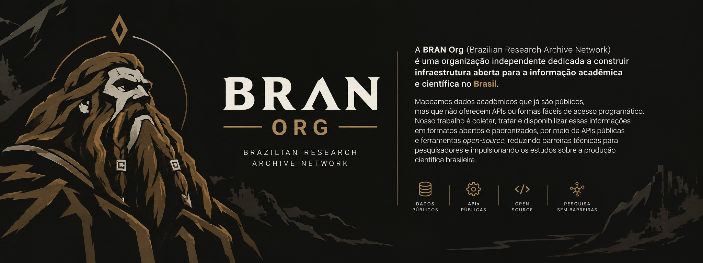

 
 
 
 

 <b><a href="ABOUT.en.md">Learn more about our story, mission, and vision in ABOUT.en.md</a></b>

---

### Databases & Collections

Public catalog of bibliometric databases from Brazilian scientific output, provided in open formats (`JSON`/`CSV`), featuring a free REST API and interactive dashboard for analysis.

| Repository | Historical Collection / Source | Records | Data Reliability |
| :--- | :--- | :---: | :---: |
| [enancib-open-database](https://github.com/BRAN-Org/enancib-open-database) | [ENANCIB (1994-2026)](https://enancib.ancib.org/) | **6,998 Articles** (1994-2026) | [🟢 Audited & Validated](#-data-reliability-levels) |
| [datagramazero-open-database](https://github.com/BRAN-Org/datagramazero-open-database) | [DataGramaZero (1999-2015)](http://hdl.handle.net/20.500.11959/1269) | **466 Articles** (1999-2015) | [🟢 Audited & Validated](#-data-reliability-levels) |
| [abec-open-database](https://github.com/BRAN-Org/abec-open-database) | [ABEC Meeting (2013-2025)](https://www.abecbrasil.org.br/) | **259 Articles** (2013-2025) | [🟠 Under Investigation](#-data-reliability-levels) |
| [ebbc-open-database](https://github.com/BRAN-Org/ebbc-open-database) | [EBBC (2012-2024)](https://ebbc.inf.br) | **643 Articles** (2012-2024) | [🟡 Faithful to Source (Incomplete Coverage)](#-data-reliability-levels) |

> 📅 **Data Governance & Ongoing Curation:** Routine verification and update cycles follow our [Curation Calendar](CALENDAR.md). You can also subscribe to the [iCal (.ics) feed](https://raw.githubusercontent.com/BRAN-Org/.github/main/calendar.ics) in Google Calendar to keep track of upcoming milestones.

<b>Data Reliability Levels</b>

 

To ensure academic transparency and methodological rigor, each **BRAN Org** dataset receives an explicit reliability classification:

- 🟢 **Audited & Validated**: Data audited and validated with methodological rigor, integrity checks, and direct verification against original proceedings and publications.
- 🟡 **Faithful to Source / Incomplete Coverage**: The dataset mirrors records available from the primary source, with explicit technical documentation of any historical gaps (such as non-digitized years or absent source DOIs). *(Ex: `ebbc-open-database`)*.
- 🟠 **Under Investigation**: Extracted data actively undergoing technical integrity audits, metadata normalization, and identifier checks. *(Ex: `abec-open-database`)*.
- 🔴 **Unaudited**: Raw or newly extracted datasets that have not yet undergone integrity checks.

> **Official Methodological Note:** 
> *BRAN strictly preserves primary source fidelity and never hallucinates missing information. Gaps and anomalies found on source portals are documented and handled technically in audit reports.*

---

## Get Involved

This community has a [Code of Conduct](CODE_OF_CONDUCT.md). You must follow it when interacting with the community.

- **For questions or support:** see [SUPPORT.md](SUPPORT.md) or send a message via our [Contact Form](https://forms.gle/qhVXZpaRo26MLuUm8).
- **To help or contribute:** see [CONTRIBUTING.md](CONTRIBUTING.md).
- **To submit datasets or collections:** fill out the [Dataset Submission Form](https://forms.gle/jNBuP1mjyUXc6v1fA).
